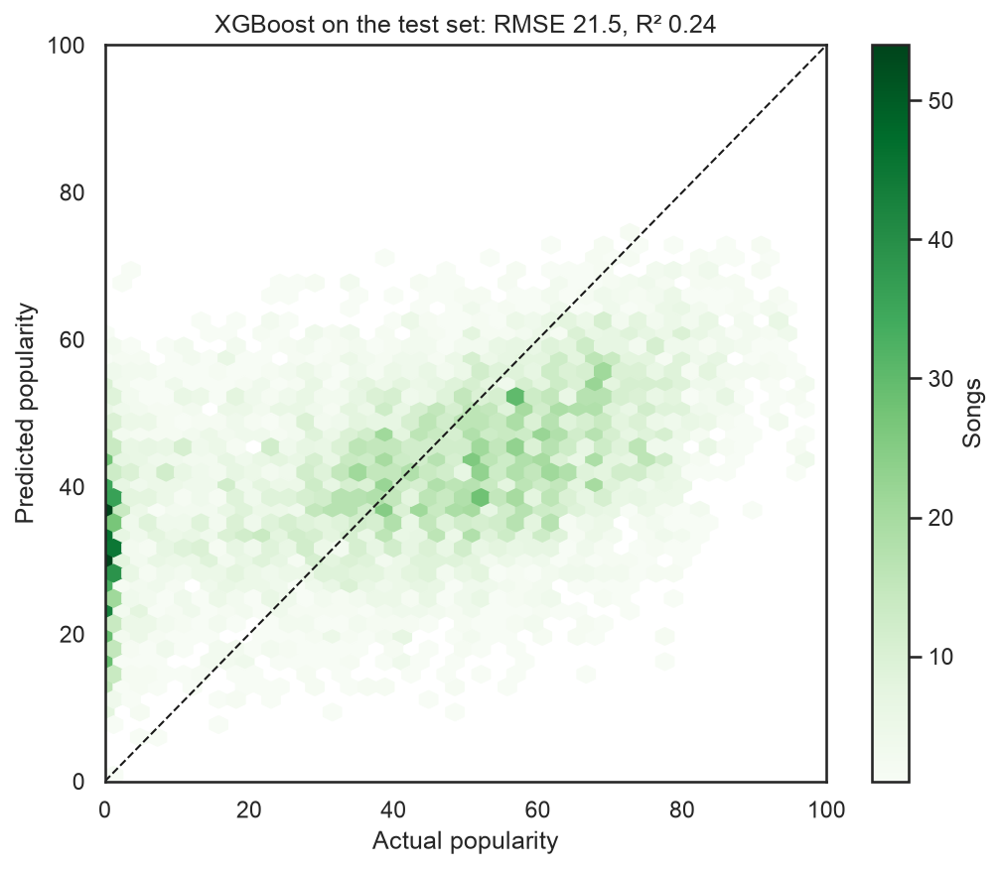
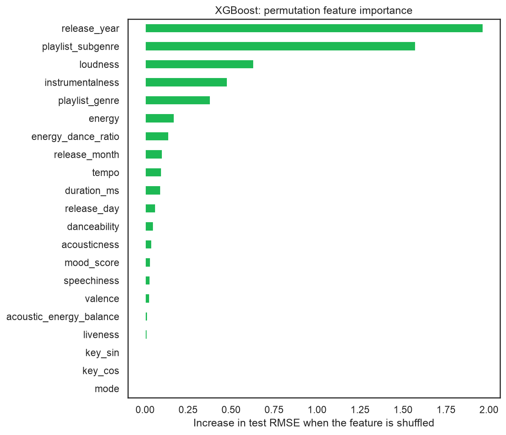

<h1 align="center">Spotify Song Popularity Prediction</h1>

<p align="center">
  Predicting a song's Spotify popularity (0–100) from its audio features, release date and playlist genre with XGBoost, LightGBM and CatBoost.
</p>

<p align="center">
  
  
  <a href="LICENSE"></a>
</p>



## Overview

The analysis uses 32,833 rows of Spotify playlist songs (28,356 unique tracks) to see how much of a song's popularity can be explained by how it sounds, when it came out and what genre of playlist it's in. The short answer is about a quarter: the best models reach R² 0.24.

All of the work is in [`notebooks/spotify_popularity_prediction.ipynb`](notebooks/spotify_popularity_prediction.ipynb).

## Approach

- **Repeat songs.** 4,477 rows are a song that's already in the data under the same `track_id`, from a different playlist, with the same popularity. The train/test split and the CV folds are grouped by `track_id` so no song is in both.
- **Feature engineering.** Sine/cosine encoding of musical key, three audio interactions (energy/danceability ratio, acousticness minus energy, valence × energy), and release year, month and day. Month and day are left missing for the 1,886 albums whose release date is only a year or year-month.
- **Preprocessing.** Scaling, one-hot encoding for genre, subgenre and mode, and tempo quartile bins, all inside the model pipeline so they're fit on training folds only.
- **Models.** XGBoost, LightGBM and CatBoost, each tuned with `GridSearchCV` (8 candidates, grouped 3-fold CV, MSE scoring).
- **Evaluation.** RMSE, R² and MAE on a held-out 20% test set, compared with a baseline that always predicts the training mean, plus residual plots and permutation feature importance.

## Results

Test set (6,519 rows):

| Model | RMSE | R² | MAE |
|-------|-----:|---:|----:|
| XGBoost | 21.48 | 0.244 | 17.68 |
| LightGBM | 21.49 | 0.244 | 17.68 |
| CatBoost | 21.49 | 0.244 | 17.74 |
| Baseline (training mean) | 24.71 | 0.000 | 20.67 |

- All three models cut RMSE by about 3 points over the baseline and are tied to within 0.01. CV RMSE (21.79–21.80) is close to the test RMSE.
- The models explain about a quarter of the variation in popularity, and the typical error (MAE 17.7) is large on a 0–100 scale.
- **Release year and playlist subgenre** drive most of the predictions, followed by loudness, instrumentalness and playlist genre. Key and mode add nothing.
- 545 test songs (8.4%) have popularity 0. The model predicts 30.4 for them on average, which is the column of points at 0 in the chart above.



## Dataset

[Spotify Songs](https://github.com/rfordatascience/tidytuesday/tree/master/data/2020/2020-01-21) from TidyTuesday (January 2020), collected from the Spotify Web API with the `spotifyr` R package. Also on [Kaggle](https://www.kaggle.com/datasets/joebeachcapital/30000-spotify-songs). Column descriptions are in [`data/readme.md`](data/readme.md).

| Group | Columns |
|-------|---------|
| Audio features | `danceability`, `energy`, `key`, `loudness`, `mode`, `speechiness`, `acousticness`, `instrumentalness`, `liveness`, `valence`, `tempo`, `duration_ms` |
| Release | `track_album_release_date` |
| Playlist | `playlist_genre` (6 genres), `playlist_subgenre` |
| IDs and names (not used as features) | `track_id`, `track_name`, `track_artist`, `track_album_id`, `track_album_name`, `playlist_id`, `playlist_name` |
| Target | `track_popularity` (0–100) |

## Limitations

- **Missing drivers.** Artist popularity, marketing and playlist placement aren't in the data, which caps how well any model on these features can do.
- **Genre comes from the playlist.** Two of the top five features are playlist labels, not properties of the song, and the same song can be in playlists of different genres.
- **Same song, different IDs.** A single and its album version have different `track_id`s, so near-duplicates can still land on both sides of the split.
- **Popularity 0.** The spike of zero-popularity songs isn't explained by any feature and pulls the errors up.
- **One snapshot.** Popularity is from a single pull around January 2020, so the results don't show how it changes over time.

## Getting started

### Prerequisites

- Python 3.12
- On macOS, the OpenMP runtime for XGBoost and LightGBM: `brew install libomp`

### Installation

```bash
git clone https://github.com/Yahlawat/Spotify-Popularity-Prediction.git
cd Spotify-Popularity-Prediction

python3 -m venv .venv
source .venv/bin/activate

pip install -r requirements.txt
```

### Data

`data/spotify_songs.csv` is included in the repo. To download it again from the original source:

```bash
curl -L -o data/spotify_songs.csv https://raw.githubusercontent.com/rfordatascience/tidytuesday/master/data/2020/2020-01-21/spotify_songs.csv
```

### Run

```bash
jupyter notebook notebooks/spotify_popularity_prediction.ipynb
```

Running the whole notebook takes under two minutes on a laptop. Results are reproducible with the fixed random seed (42). Tested with Python 3.12, pandas 3.1, scikit-learn 1.9, XGBoost 3.4, LightGBM 4.7 and CatBoost 1.2.

## Project structure

```
.
├── notebooks/
│   └── spotify_popularity_prediction.ipynb   # Full analysis
├── data/
│   ├── spotify_songs.csv                     # Dataset
│   └── readme.md                             # Source and data dictionary
├── images/                                   # Figures saved by the notebook
├── requirements.txt
├── LICENSE
└── README.md
```

## License

Released under the [MIT License](LICENSE).
